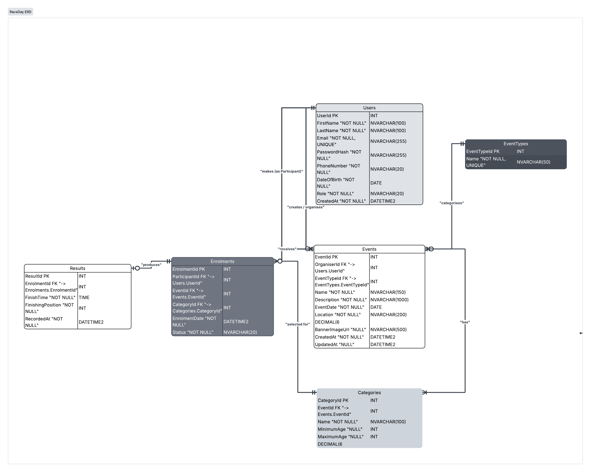
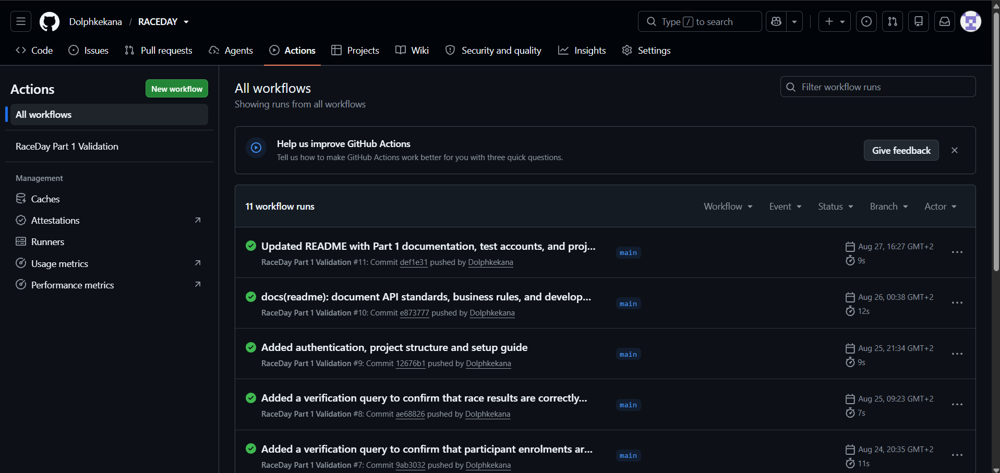

# RaceDay

RaceDay is an ASP.NET Core Web API for managing community sports events. The system allows organisers to create and manage events, categories, participant enrolments and race results, while participants can register, browse events, enrol in events and view their results.

The project is being developed as part of the RaceDay API assignment and follows a planning-first approach. The database design and API contract are defined before the main API implementation.

---

## Project Overview

RaceDay supports two main user roles.

### Organiser

An Organiser can:

- Create and manage events.
- Manage event categories.
- View participants enrolled in their events.
- Update enrolment statuses.
- Record participant results.
- Correct recorded results.


### Participant

A Participant can:

- Create an account.
- Log in and log out.
- View and update their profile.
- Browse upcoming events.
- View event details and categories.
- Enrol in events.
- View their own enrolments.
- View their personal race results.

---


## Technology Stack


| Technology            | Purpose                       |
| --------------------- | ----------------------------- |
| ASP.NET Core Web API  | REST API                      |
| C#                    | Application development       |
| Entity Framework Core | Database access and ORM       |
| SQL Server            | Relational database           |
| ASP.NET Core Session  | Session-based authentication  |
| Swagger / OpenAPI     | API documentation and testing |
| xUnit                 | Automated testing             |
| Git / GitHub          | Version control               |
| GitHub Actions        | Continuous Integration        |


---
## Database Design




## Core Tables


| Table      | Purpose                                                                      |
| ---------- | ---------------------------------------------------------------------------- |
| Users      | Stores Organiser and Participant accounts.                                   |
| EventTypes | Stores the types of events supported by RaceDay.                             |
| Events     | Stores event information and links events to Organisers and EventTypes.      |
| Categories | Stores the age and distance categories available for each event.             |
| Enrolments | Links Participants to Events and records their selected category and status. |
| Results    | Stores finishing information for an enrolment.                               |


The database uses:

- Primary keys.
- Foreign keys.
- Unique constraints.
- Check constraints.
- NOT NULL constraints.
- Indexes on frequently queried fields and relationships.
- Referential integrity between related entities.

The complete database script is located at:

```
/docs/RaceDay-Database.sql
```
## API Design

RaceDay follows a REST-style API structure.

### Authentication

```
POST /api/auth/register
POST /api/auth/login
POST /api/auth/logout
```


### User Profile

```
GET  /api/users/me
PUT  /api/users/me
```


### Events

```
GET    /api/events
GET    /api/events/{eventId}
POST   /api/events
PUT    /api/events/{eventId}
DELETE /api/events/{eventId}
```


### Event Types

```
GET /api/event-types
GET /api/event-types/{eventTypeId}
```


### Categories

```
GET    /api/events/{eventId}/categories
GET    /api/categories/{categoryId}
POST   /api/events/{eventId}/categories
PUT    /api/categories/{categoryId}
DELETE /api/categories/{categoryId}
```


### Enrolments

```
POST /api/events/{eventId}/enrolments
GET  /api/enrolments/my
GET  /api/enrolments/{enrolmentId}
GET  /api/events/{eventId}/enrolments
PUT  /api/enrolments/{enrolmentId}/status
```


### Results

```
POST /api/enrolments/{enrolmentId}/result
PUT  /api/results/{resultId}
GET  /api/results/my
```

The complete API specification is available in:

```
/docs/RaceDay_API_Endpoint_Plan.md
```

The endpoint plan contains the HTTP methods, routes, descriptions, role requirements, request bodies and expected response codes.
## Authentication and Authorisation

RaceDay uses session-based authentication.

The API must:

- Authenticate users using their email and password.
- Store the authenticated user's identity and role in the server-side session.
- Protect endpoints that require authentication.
- Enforce Organiser-only operations.
- Enforce Participant-only operations.
- Prevent users from accessing resources they do not have permission to manage.
- Never return password hashes through API responses.


### Access Model


| Feature               | Public | Organiser | Participant |
| --------------------- | ------ | --------- | ----------- |
| Register              | Yes    | Yes       | Yes         |
| Login                 | Yes    | Yes       | Yes         |
| Browse events         | Yes    | Yes       | Yes         |
| Create event          | No     | Yes       | No          |
| Manage own events     | No     | Yes       | No          |
| Enrol in event        | No     | No        | Yes         |
| View own enrolments   | No     | No        | Yes         |
| View event enrolments | No     | Yes       | No          |
| Record results        | No     | Yes       | No          |
| View own results      | No     | No        | Yes         |


## Project Structure

The repository structure is:

```
RACEDAY/
│
├── docs/
│   ├── RaceDayERD.png
│   ├── RaceDay_API_Endpoint_Plan.md
│   ├── RaceDay-Database.sql
│   └── ci-run.png
│
├── src/
│   └── RaceDay.Api/
│       ├── Auth/
│       ├── Contracts/
│       ├── Controllers/
│       ├── Data/
│       │   └── Migrations/
│       ├── Documentation/
│       ├── Models/
│       ├── Services/
│       └── Program.cs
│
├── tests/
│   └── RaceDay.Api.Tests/
│
├── .github/
│   └── workflows/
│       ├── part1-validation.yml
│       └── part2-ci.yml
│
├── README.md
└── RaceDay.sln
```

## Getting Started


### Prerequisites

Install the following:

- .NET SDK compatible with the project target framework.
- SQL Server or SQL Server Express.
- SQL Server Management Studio (SSMS).
- Git.
- Visual Studio or Visual Studio Code.


### 1. Clone the Repository

```bash
git clone <https://github.com/Dolphkekana/RACEDAY>
cd RACEDAY
```


### 2. Create the Database

Open:

```
/docs/RaceDay-Database.sql
```

Run the script in SQL Server Management Studio.

The script creates:

- The RaceDay database.
- All six database tables.
- Primary and foreign keys.
- Validation constraints.
- Unique constraints.
- Indexes.
- Sample data.
- Verification queries.


### 3. Configure the Connection String

Update the application's configuration with the SQL Server connection string.

Example:

```json
{
  "ConnectionStrings": {
    "DefaultConnection": "Server=localhost;Database=RaceDay;Trusted_Connection=True;TrustServerCertificate=True;"
  }
}
```

The actual connection string should match the SQL Server installation being used.
### 4. Restore Dependencies

From the project directory:

```bash
dotnet restore
```


### 5. Build the Project

```bash
dotnet build
```


### 6. Run the API

```bash
dotnet run
```

The terminal will display the local address used by the application.

### 7. Open Swagger

When the API is running, open the Swagger URL shown by the application.

Swagger will provide an interactive view of the API endpoints and will be used to test the API during development.

## Testing

The project will use automated tests to verify important API behaviour.

Testing will cover:

- User registration.
- Login and logout.
- Invalid authentication.
- Role-based access control.
- Event creation.
- Event updates.
- Event deletion.
- Category management.
- Participant enrolment.
- Duplicate enrolment prevention.
- Enrolment status updates.
- Result creation.
- Result updates.
- Result retrieval.
- Invalid IDs.
- Missing resources.
- Validation failures.

Run the automated tests with:

```bash
dotnet test
```
## HTTP Response Standards

The API uses standard HTTP response codes.


| Code             | Usage                                                    |
| ---------------- | -------------------------------------------------------- |
| 200 OK           | Successful request returning data.                       |
| 201 Created      | Resource successfully created.                           |
| 204 No Content   | Successful request with no response body.                |
| 400 Bad Request  | Invalid request data.                                    |
| 401 Unauthorized | Authentication is required or invalid.                   |
| 403 Forbidden    | User is authenticated but lacks permission.              |
| 404 Not Found    | Requested resource does not exist.                       |
| 409 Conflict     | Request conflicts with existing data or a business rule. |


## Validation and Business Rules

The API validates incoming data before writing it to the database.

Important rules include:

- Email addresses must be unique.
- User roles must be valid.
- Event distances must be greater than zero.
- Category ages must be valid.
- Category age ranges must be logical.
- An enrolment must reference an existing event.
- An enrolment must reference an existing category.
- A selected category must belong to the event being entered.
- A Participant cannot enrol in the same event more than once.
- An enrolment can have at most one result.
- Finishing positions must be greater than zero.
- Organisers may only manage events they own.
- Participants may only access their own participant-specific information.
- Invalid or unauthorised requests must return appropriate HTTP status codes.


## Development Workflow

RaceDay follows a staged development process.

```
Part 1
  |
  +-- Database Design
  |
  +-- ERD
  |
  +-- API Endpoint Plan
  |
  +-- SQL Script
  |
  +-- Repository / CI Setup
  |
  v
Part 2
  |
  +-- ASP.NET Core API
  +-- Authentication
  +-- Entity Framework Core
  +-- Controllers / Services
  +-- Validation
  +-- Swagger
  +-- Automated Tests
  +-- CI/CD
```

The Part 1 database and API documents form the specification for the Part 2 implementation.
## Documentation

Part 1 documentation is stored inside the `/docs` directory.


| File                         | Description                                                                             |
| ---------------------------- | --------------------------------------------------------------------------------------- |
| RaceDayERD.png              | Entity Relationship Diagram showing the database entities and relationships.            |
| RaceDay_API_Endpoint_Plan.md | Complete REST API endpoint specification.                                               |
| RaceDay-Database.sql         | SQL Server database creation, constraints, indexes, seed data and verification queries. |
| ci-run.png                   | Screenshot of a successful GitHub Actions CI build.                                     |

## CI Successful Build

Evidence of a successful **RaceDay Part 1 Validation** workflow run on GitHub Actions:



## Sample Accounts

The database contains development accounts for testing.


| Role        | Email                                                               |
| ----------- | ------------------------------------------------------------------- |
| Organiser   | [adolf.kekana@raceday.co.za](mailto:adolf.kekana@raceday.co.za) |
| Organiser   | [kabelo.dlamini@raceday.co.za](mailto:kabelo.dlamini@raceday.co.za) |
| Participant | [thabang.sekwati@example.com'](mailto:thabang.sekwati@example.com') |
| Participant | [amanda.nkosi@example.com](mailto:amanda.nkosi@example.com)         |


Development password:

```
RaceDay@2026
```

These accounts are intended for local development and testing only.

Production credentials must be secure and must never be committed to source control.

## Project Status


### Part 1

- [x] ERD designed.
- [x] API endpoint plan created.
- [x] SQL Server database script created.
- [x] Database relationships defined.
- [x] Primary and foreign keys defined.
- [x] Validation constraints defined.
- [x] Indexes defined.
- [x] Sample data prepared.
- [x] SQL script tested in the target SQL Server environment.
- [x] Repository and CI evidence completed.


### Part 2

- [ ] ASP.NET Core Web API implementation.
- [ ] Entity Framework Core integration.
- [ ] Session-based authentication.
- [ ] Role-based authorisation.
- [ ] Event management.
- [ ] Category management.
- [ ] Participant enrolments.
- [ ] Result management.
- [ ] Swagger documentation.
- [ ] Automated tests.
- [ ] CI/CD pipeline.


## Repository Quality

The repository aims to maintain:

- Clear project structure.
- Meaningful naming conventions.
- Small and focused commits.
- Useful comments where logic is not immediately obvious.
- No committed secrets.
- Repeatable database setup.
- Documented API behaviour.
- Automated build and test checks.
- Consistency between the Part 1 design and Part 2 implementation.